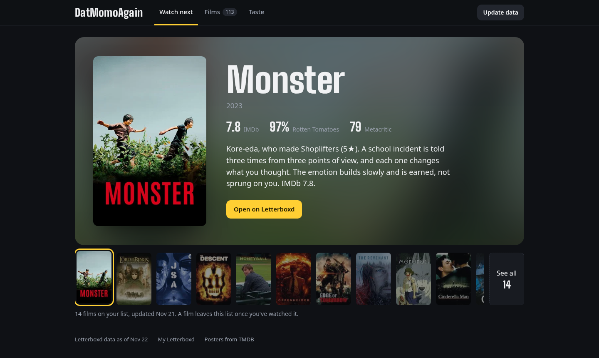
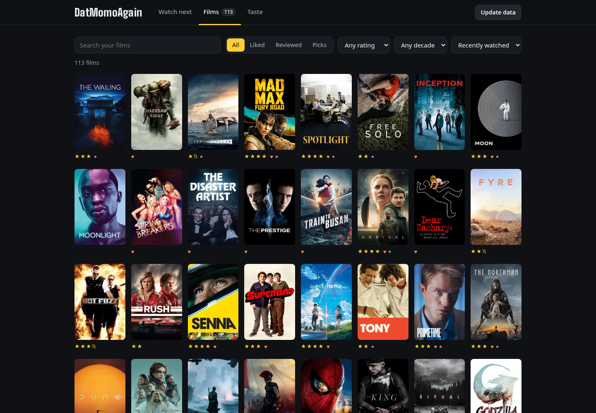
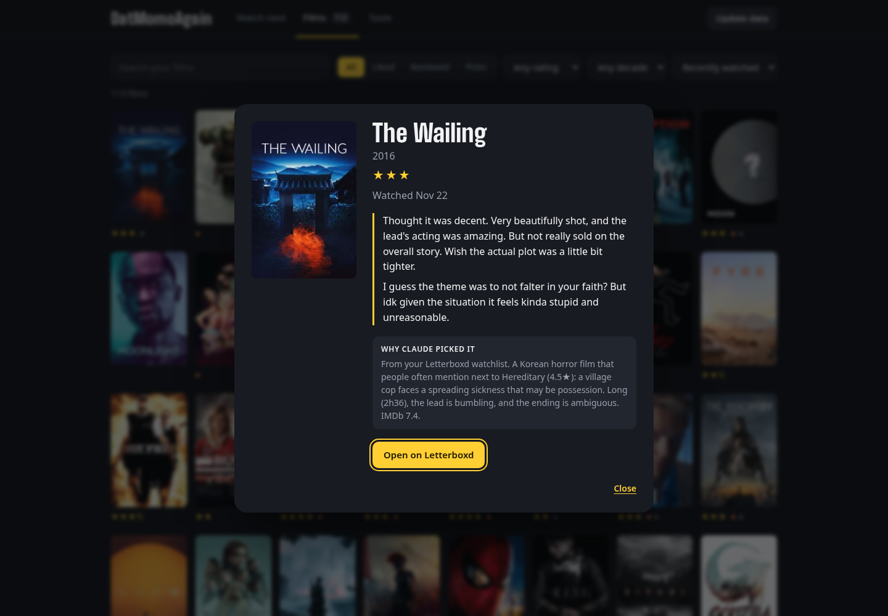
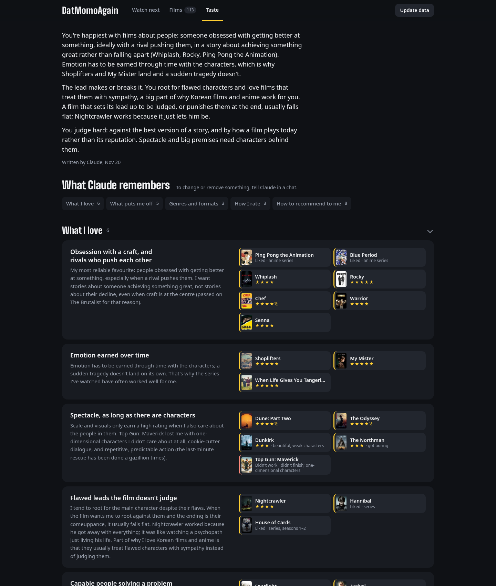

# personal-letterboxd-mcp

A personal, single-user [MCP](https://modelcontextprotocol.io) server on Cloudflare Workers that gives Claude
(claude.ai, the apps, and Claude Code) access to your Letterboxd history, so film recommendations
are based on what you've actually watched and what you wrote about it.

It works from Letterboxd's official data export, not scraping and not your password.

## What it looks like

The private page, with my own data:










## What it does

**For Claude (MCP tools)**
- Read: taste summary, every watched film (`get_watched`), diary, reviews, watchlist, and "have I
  seen these?" (`has_seen`, a whole list at once), with your review text attached wherever a film
  appears. `find_film` looks up IMDb ids, ratings and vote counts, so recommendations quote real scores.
- Taste memory: Claude saves what it learns about your taste (`remember`, `update_note`, `forget`)
  in your own Cloudflare KV, not in Claude's memory, and reads it first in every chat. It asks before
  every write, and its instructions guard against overcorrecting: one review isn't a general rule,
  a proposed note gets checked against the rest of your ratings first, and one missed recommendation
  is no reason to rewrite your taste.
- Your watch list (`save_picks`, `update_pick`, `remove_picks`): films you decide to watch in a chat,
  each with Claude's reason. Each carries an IMDb id the server checks on save, so scores always
  belong to the right film. Once you've watched one, its reason is kept: Claude sees it as
  `pickedBecause` whenever it looks that film up, next to your rating and review, so it can learn
  what landed.
- A written overview of your taste for the personal page (`save_overview`).

**For you (a private web page)**
- **Watch next:** your watch list one film at a time on a poster stage (films leave it once you've
  watched them), with Claude's reason and IMDb, Rotten Tomatoes and Metacritic scores linking to each site.
- **Films:** a poster wall of everything you've watched, with stars, a heart on liked films, search,
  filters (liked, reviewed, Claude's picks, rating, decade) and sorting. Selecting a film shows your
  rating, watch dates and review, and for a past pick, why Claude picked it.
- **Taste:** Claude's overview, then its notes about you grouped by topic. Each note is a theme with a
  headline, the detail, and example films showing your rating and how each landed. Rating and decade
  charts jump to the matching films.
- An upload dialog for a new Letterboxd export ZIP, so it works from any device.
- Server-rendered HTML with one small inline script (per-request CSP nonce, no network access, no
  third-party code), no-referrer, noindex. Without JavaScript it's one long readable page.

## Talking to it

It works best when you say which of three things you want: talk about a film, get recommendations,
or review your taste notes. Asking "anything you want to revise?" invites Claude to find changes.

**After watching something** (the best source of taste notes)
> Just watched The Revenant, gave it 3.5. Let's talk about it.

> Logged Moneyball. Ask me anything you're unsure about from my review.

Claude asks questions, and notes come from what you say, not from reading too much into one review.

**Recommendations**
> Recommend 5 films for tonight. In the mood for something tense, under 2 hours.

> Something like Spotlight: capable people solving a problem.

> Pick one film from my watch next list for tonight.

A mood only counts for that chat. A count and a running time keep the list focused.

**Reviewing your taste notes** (now and then, not after every film)
> Review my taste notes against my whole history. Flag anything contradicted or out of date, but
> don't propose new notes.

> Is there a pattern in my last 10 ratings that shows up across several films? Only flag it if it's in more than one.

> How did your recent picks land?

If Claude reads too much into something, "that was just about that film" is enough to correct it.

## How access works

There's no login. The MCP endpoint and the page live at `/mcp/<token>` and `/home/<token>`, where
`<token>` is a long random secret (`MCP_TOKEN`). Everything else returns 404. Treat both URLs like
passwords.

## Setup

Requires Node 22+ and a Cloudflare account (the free plan is plenty).
For posters, also a free [TMDB](https://www.themoviedb.org/settings/api) account: use its
**API Read Access Token** (not the shorter API Key). Without it everything works, just without posters.
For scores on picks, a free [OMDb](https://www.omdbapi.com/apikey.aspx) API key (click the
activation link in its email). Without it, picks just show no scores.

```sh
npm install
npx wrangler login
npx wrangler kv namespace create LETTERBOXD   # put the id in wrangler.jsonc
openssl rand -hex 32 | npx wrangler secret put MCP_TOKEN
npx wrangler secret put TMDB_TOKEN            # optional: TMDB "API Read Access Token", for posters
npx wrangler secret put OMDB_KEY              # optional: OMDb API key, for IMDb/RT/Metacritic scores
npm run deploy
```

Then add `https://<your-worker>.workers.dev/mcp/<token>` as a custom connector in claude.ai
(Settings → Connectors), and open `/home/<token>` to upload your export
(letterboxd.com → Settings → Data → Export your data). You can also upload from the command line:
`npm run upload -- path/to/export.zip`.

## Development

```sh
npm test           # vitest
npx tsc --noEmit   # type check
```

Code lives in `src/`: `index.ts` (routing and auth), `server.ts` (MCP tools and instructions),
`queries.ts` (reading the export), `memory.ts` (taste memory), `page.ts` (the personal page's HTML and
CSS), `pageScript.ts` (its inline script), `posters.ts` (TMDB lookups, cached in KV), `ratings.ts`
(OMDb scores, cached in KV), `exportZip.ts` / `dataset.ts` (parsing the export).

Poster images are provided by [TMDB](https://www.themoviedb.org). This product uses the TMDB API
but is not endorsed or certified by TMDB. The display font is
[Big Shoulders](https://github.com/xotypeco/big_shoulders) (SIL Open Font License, see `src/fonts/LICENSE`),
bundled into the Worker and served under the secret path.
