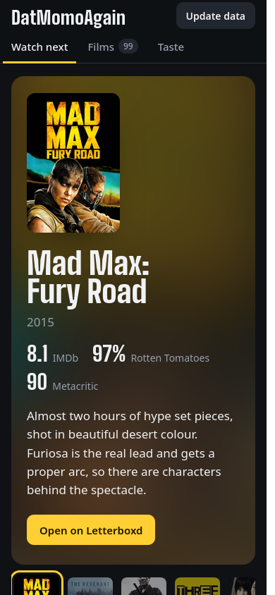

# personal-letterboxd-mcp

A personal, single-user [MCP](https://modelcontextprotocol.io) server on Cloudflare Workers that gives Claude
(claude.ai, the apps, and Claude Code) access to your Letterboxd history, so film recommendations
are based on what you've actually watched and what you wrote about it.

It works from Letterboxd's official data export, not scraping and not your password.

## What it looks like

The private page, with my own data:




## What it does

**For Claude (MCP tools)**
- Read: taste summary, ratings, diary, reviews, watchlist, and "have I seen this?", with your review
  text attached wherever a film appears.
- Taste memory: Claude saves what it learns about your taste (`remember`, `update_note`, `forget`)
  in your own Cloudflare KV, not in Claude's memory, and reads it first in every chat.
- Saves its recommendations and a written overview of your taste for the personal page. Each
  saved pick carries an IMDb id, which Claude gets from `find_film` (a TMDB search) and the server
  checks on save, so scores always belong to the right film.

**For you (a private web page)**
- **Watch next:** Claude's picks one at a time on a poster stage (they disappear once you've watched
  them), with IMDb, Rotten Tomatoes and Metacritic scores linking to each site.
- **Films:** a poster wall of everything you've watched, with search, filters (liked, reviewed, rating,
  decade) and sorting. Selecting a film shows your rating, watch dates and review.
- **Taste:** Claude's overview, then its notes about you grouped by topic. Each note is a theme with a
  headline, the detail, and example films showing your rating and how each landed. Rating and decade
  charts jump to the matching films.
- An upload dialog for a new Letterboxd export ZIP, so it works from any device.
- Server-rendered HTML with one small inline script (per-request CSP nonce, no network access, no
  third-party code), no-referrer, noindex. Without JavaScript it's one long readable page.

## How access works

There's no login. The MCP endpoint and the page live at `/mcp/<token>` and `/home/<token>`, where
`<token>` is a long random secret (`MCP_TOKEN`). Everything else returns 404. Treat both URLs like
passwords.

## Setup

Requires Node 22+ and a Cloudflare account (the free plan is plenty).
For posters, also a free [TMDB](https://www.themoviedb.org/settings/api) account: use its
**API Read Access Token** (not the shorter API Key). Without it everything works, just without posters.
For scores on picks, a free [OMDb](https://www.omdbapi.com/apikey.aspx) API key (click the
activation link in its email). Without it, picks just show no scores.

```sh
npm install
npx wrangler login
npx wrangler kv namespace create LETTERBOXD   # put the id in wrangler.jsonc
openssl rand -hex 32 | npx wrangler secret put MCP_TOKEN
npx wrangler secret put TMDB_TOKEN            # optional: TMDB "API Read Access Token", for posters
npx wrangler secret put OMDB_KEY              # optional: OMDb API key, for IMDb/RT/Metacritic scores
npm run deploy
```

Then add `https://<your-worker>.workers.dev/mcp/<token>` as a custom connector in claude.ai
(Settings → Connectors), and open `/home/<token>` to upload your export
(letterboxd.com → Settings → Data → Export your data). You can also upload from the command line:
`npm run upload -- path/to/export.zip`.

## Development

```sh
npm test           # vitest
npx tsc --noEmit   # type check
```

Code lives in `src/`: `index.ts` (routing and auth), `server.ts` (MCP tools and instructions),
`queries.ts` (reading the export), `memory.ts` (taste memory), `page.ts` (the personal page's HTML and
CSS), `pageScript.ts` (its inline script), `posters.ts` (TMDB lookups, cached in KV), `ratings.ts`
(OMDb scores, cached in KV), `exportZip.ts` / `dataset.ts` (parsing the export).

Poster images are provided by [TMDB](https://www.themoviedb.org). This product uses the TMDB API
but is not endorsed or certified by TMDB. The display font is
[Big Shoulders](https://github.com/xotypeco/big_shoulders) (SIL Open Font License, see `src/fonts/LICENSE`),
bundled into the Worker and served under the secret path.
